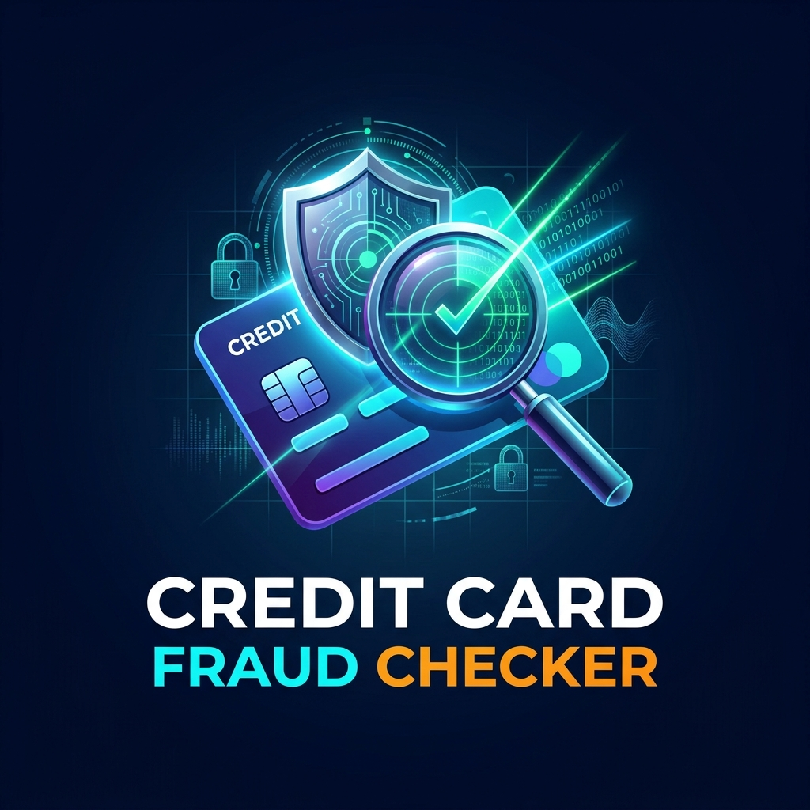

# Credit Card Fraud Checker

A simple, beginner-friendly website that checks whether a credit card transaction looks suspicious.

**Live site:** https://muzahid46.github.io/Credit-Card-Fraud-Checker-/

## Features
- Select the country where the transaction was made (Asia, Americas, Africa, Europe, Oceania)
- Amount field shows the local currency symbol
- Rule-based risk score from 0 to 100
- Clear result: Looks safe, Suspicious, or High risk, with reasons

## How it works
The score goes up when a transaction has warning signs, such as:
- Very large amount
- Late-night time (12 AM to 5 AM)
- Made outside the home country
- Many transactions within one hour
- Online payment
- First time at a shop or website

## Note
This is a learning demo. Never enter a real card number or CVV.

## Built with
HTML, CSS and JavaScript. Hosted on GitHub Pages.
